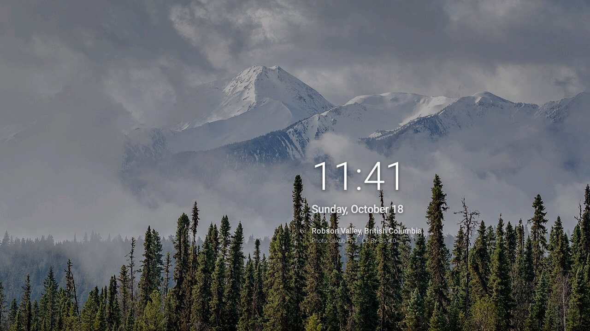

# Google TV Home

A minimal, ad-free home screen for Google TV, plus a set of adb scripts to debloat the TV and
undo every change.

Google TV's stock launcher is built around sponsored rows and recommendations. This project
replaces it with a quiet, tvOS-style home: a wallpaper, a clock, your apps, and nothing else.
It was built on a TCL G13 (Android 14). The launcher and scripts are plain Android and adb and
should work on other Google TV devices; the debloat lists are TCL-specific.

Nothing is uninstalled. Packages are disabled for the current user, and one command puts the
TV back the way it was.


| | |
|---|---|
|  |  |
| Down from the dock: every other app, then TV inputs; long-press to add one to the dock | Screensaver: the photos, with a clock that moves each minute |

## Features

- **Dock** of your favourite apps on a frosted-glass band. Long-press a tile to move or remove
  it; long-press one in the app grid to add it. TV inputs (HDMI ports) can go in the dock too.
- **App grid:** press down from the dock and every other app scrolls into view. Back returns
  to the dock.
- **Now playing:** a card for whatever is playing in the background (Spotify, say), with art,
  progress and playback controls. Hidden when nothing is playing.
- **Focus highlight** that springs from tile to tile as you move with the remote.
- **Rotating wallpapers** from Wikimedia Commons featured pictures, with credits on screen: lakes,
  mountains, forests, coasts and night skies. Pick which categories to show, how often the photo
  changes, or a plain dark colour instead.
- **Input tiles your way:** give an HDMI input an icon (game console, set-top box, disc player,
  computer, or none) and a colour.
- **Screensaver** (optional): the same photos crossfading, with the time and date.
- **Quick access** to the input switcher and Settings, top right; each spells out its name when
  focused.
- **Settings button works again:** with the stock launcher disabled, the remote's Settings key
  does nothing; the launcher catches it and opens Settings from any app.
- **Options and Info buttons:** Options opens a tile's menu, the same as a long-press, where apps
  you installed can also be uninstalled; anywhere else, it opens Customize home. Info shows the
  launcher's version and where it's from.
- **Fully reversible** debloat, with a backup taken before anything changes.

## Requirements

- A Google TV with developer options and network (or USB) debugging enabled
- `adb`
- JDK 17 and Android SDK platform 34 with build-tools 34.0.0

On macOS: `brew install openjdk@17 android-commandlinetools`. `launcher/build.sh` uses the
Homebrew paths by default; set `JAVA_HOME` and `ANDROID_SDK_ROOT` to use others. There is no
Gradle: the build is a single shell script.

## Setup

1. **Enable developer options on the TV.** Settings > System > About, select *Android TV OS
   build* 7 times. Then in Settings > System > Developer options, turn on *USB debugging* (and
   *Network debugging* on some models). Note the TV's IP address under Settings > Network &
   Internet.

2. **Connect**, and accept the prompt on the TV:
   ```sh
   export ANDROID_SERIAL=<tv-ip>:5555
   adb connect $ANDROID_SERIAL
   ```

3. **Back up, then debloat.** Review `config/debloat.txt` first and comment out anything you
   use. `examples/` has a list for an older TCL model.
   ```sh
   tools/backup.sh
   tools/disable.sh -f config/debloat.txt
   ```

4. **Build and install the launcher**, and make it Home:
   ```sh
   launcher/build.sh
   tools/set-home.sh
   ```

The first build creates a signing key at `launcher/keystore/release.jks` (gitignored). Keep it:
updates must be signed with the same key, or the old build has to be uninstalled first.

### Customising

- **On the TV:** press Options (or long-press a tile) and pick *Customize home* for the
  background: photos from the categories you choose, or a plain colour, and how often the photo
  changes. An input tile's menu also has *Change icon* and *Change colour*. Info opens Customize
  home too.
- **Wallpapers:** photos and their categories are listed in `launcher/res/raw/walls.txt`, with
  credits in [`launcher/WALLPAPERS.md`](launcher/WALLPAPERS.md).
- **Default dock:** edit `launcher/res/raw/dock.txt`. Changes made on the TV override it.
- **Screensaver:** turn it on with
  ```sh
  adb shell settings put secure screensaver_components io.github.samuelfonseca.tvhome/.WallpaperDream
  ```
  and off with `adb shell settings delete secure screensaver_components`.

## Undo

```sh
tools/restore.sh --dry-run          # show what it would do
tools/restore.sh                    # re-enable everything, restore the Google TV home
tools/restore.sh --remove-launcher  # ...and uninstall this launcher
```

`restore.sh` uses the latest backup in `backups/`, or pass one explicitly.

> [!WARNING]
> Don't re-enable packages by hand in a different order. On TCL firmware, `setupwraith` must be
> disabled before the stock launcher and re-enabled last: if it runs while Home is missing or
> changing, its recovery screen takes over and deletes the saved Wi-Fi network. The scripts handle
> this for you.

## Tools

| Command | What it does |
|---|---|
| `tools/backup.sh` | Save package lists, settings and the current Home to `backups/<timestamp>/` |
| `tools/disable.sh -f <list>` | Disable the packages in a list (or pass package names) |
| `tools/set-home.sh` | Install the launcher, grant its permissions and make it Home |
| `tools/restore.sh` | Undo everything, from the latest backup or a given one |
| `tools/shot.sh <name>` | Save a TV screenshot to `shots/` |
| `launcher/build.sh` | Build `launcher/build/tvhome.apk` |

## Checks

Run from the repo root. CI runs the same on every push and pull request.

```sh
launcher/build.sh   # build first: lint reads the compiled classes
launcher/test.sh    # JUnit tests on a plain JVM
launcher/lint.sh    # Android Lint; fails on any warning
shellcheck tools/*.sh launcher/*.sh
```

`test.sh` and `lint.sh` download pinned, checksum-verified copies of JUnit and Android Lint
into `~/.cache/tvhome` on first run. CodeQL also scans the Java code and workflows.

## Contributing

Contributions are welcome, especially debloat lists and fixes for other Google TV models.

1. Fork the repo and create a branch.
2. Make your change. Keep logic that doesn't need Android in its own class so it can be unit
   tested, and match the style of the surrounding code.
3. Run the [checks](#checks) and make sure they pass.
4. Open a pull request describing the change and the device you tested it on.

For a new device's debloat list, add it under `examples/` with a header naming the model,
Android version and build, like `config/debloat.txt`. Lists must never include the stock
launcher (`launcherx`) or `setupwraith`; `tools/set-home.sh` handles those, and the tests
check for it.

Found a bug? Open an issue with your TV model, Android version and steps to reproduce.

## License

[MIT](LICENSE). The wallpapers in `launcher/res/drawable-nodpi/` are not covered: each keeps
its own Creative Commons licence or public-domain status, listed in
[`launcher/WALLPAPERS.md`](launcher/WALLPAPERS.md).
