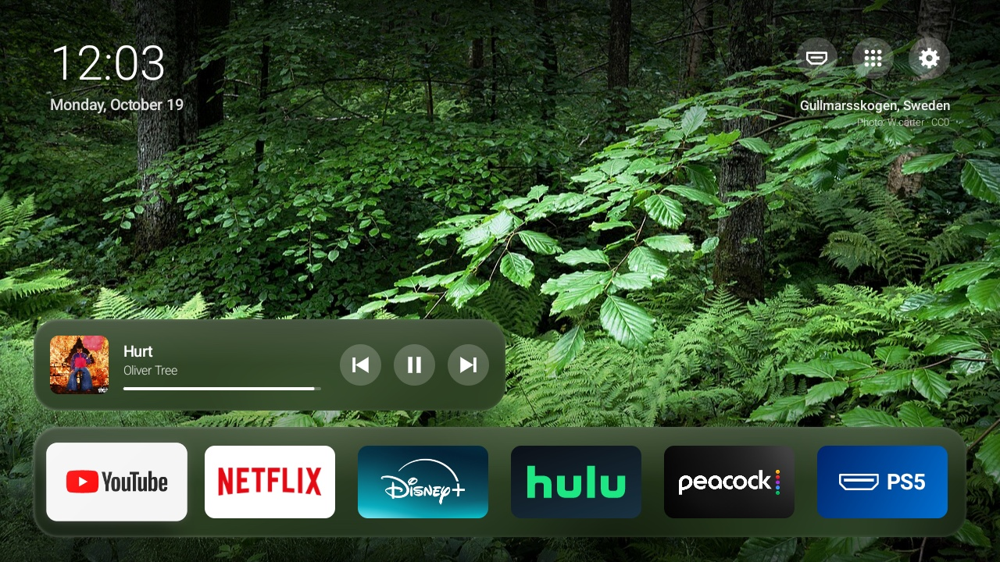

# Google TV Home

Debloat a TCL Google TV over adb and replace the Google TV home screen with a minimal launcher.
Tested on a TCL G13 (Android 14); the scripts are plain adb and should work on other Google TV
devices, but the debloat lists are TCL-specific.

Nothing is uninstalled: packages are disabled for user 0 (`pm disable-user --user 0`), and
`tools/restore.sh` puts everything back.



| | |
|---|---|
|  |  |
| Down from the dock: every other app, in a grid | All apps, then TV inputs; long-press to add one to the dock |

## The launcher
`launcher/` (package `io.github.samuelfonseca.tvhome`): rotating nature wallpapers, a clock,
and a dock of app tiles on a frosted band. Top-right buttons open the input switcher (Google
TV's own, `com.android.tv.action.VIEW_INPUTS`), All apps, and Settings.

- **Dock:** long-press a tile to move it or remove it. Long-press in All apps to add one.
- **App grid:** press down from the dock and the page scrolls up, like tvOS: the dock moves to
  the top, the wallpaper dims, and every app not in the dock follows in a grid. Back returns to
  the dock. Long-press a grid tile to add it to the dock.
- **Focus:** one glass frame (`Highlight`) springs from tile to tile across the dock and the
  grid, and fades out when focus moves to the buttons. Down into a shorter last row lands on its
  last tile; the bottom row, and the ends of the button and now-playing rows, stop the remote
  instead of jumping to whatever is nearest. The dock remembers the last app by package, so
  reordering or rebuilding it keeps your place.
  TV inputs (HDMI ports) are at the end of All apps and can go in the dock too; their tiles show
  the name from Settings > Inputs. Defaults are in `launcher/res/raw/dock.txt`, where
  `input:<id>` lines add an input (ids from `adb shell dumpsys tv_input`).
- **Now playing:** above the dock, a card for whatever plays in the background (Spotify, say):
  art, title, artist, progress, previous / play-pause / next. Select the art to open the app.
  Hidden when nothing is playing or paused. It reads media sessions through a notification
  listener (`MediaListener`), which `tools/set-home.sh` enables with
  `cmd notification allow_listener`. Without it the card stays hidden. `adb install -r`
  updates keep the permission; an uninstall drops it.
- **Remote's Settings button:** the TCL IR remote's gear sends `KEYCODE_NOTIFICATION` (scan code
  561); Google's Bluetooth remote sends `KEYCODE_SETTINGS`. The system sends both only to
  launcherx's quick-settings panel (`TOGGLE_NOTIFICATION_HANDLER_PANEL`, locked to that
  package), so with launcherx disabled the button does nothing, and apps never receive the key.
  An accessibility service (`SettingsKey`) catches either key first and opens Settings, in any
  app. `tools/set-home.sh` enables it; `tools/restore.sh` turns it off. `adb shell input keyevent`
  skips accessibility filters, so it can't test this: use the real remote, or `adb shell uinput -`
  with a fake keyboard sending Linux key 204 (`Generic.kl` maps it to NOTIFICATION).
- **Wallpapers:** Wikimedia Commons featured pictures; credits in `launcher/WALLPAPERS.md` and on
  screen.
- **Screensaver** (optional, `WallpaperDream`): the same photos crossfading every minute, with
  the time, date and photo credit. The clock moves each minute so nothing burns in. Turn it on,
  and off again:
  ```
  adb shell settings put secure screensaver_components io.github.samuelfonseca.tvhome/.WallpaperDream
  adb shell settings delete secure screensaver_components
  ```
  It starts after the screen-off timeout (`settings get system screen_off_timeout`, 10 minutes by
  default). `cmd dreams start-dreaming` needs root, so to try it sooner, lower that timeout.

## Setup
Needs `adb`, JDK 17 and Android SDK platform 34 + build-tools 34.0.0. `launcher/build.sh`
defaults to the Homebrew paths (`brew install openjdk@17 android-commandlinetools`); set
`ANDROID_SDK_ROOT` and `JAVA_HOME` to use others.

1. On the TV: Settings > System > About, select *Android TV OS build* 7 times. Then
   Settings > System > Developer options: turn on *USB debugging* (and *Network debugging* on
   some models). Find the TV's IP under Settings > Network & Internet.
2. Connect and accept the prompt on the TV:
   ```
   export ANDROID_SERIAL=<tv-ip>:5555
   adb connect $ANDROID_SERIAL
   ```
3. Back up the current state, then debloat. Edit `config/debloat.txt` first: comment out
   anything you use. `examples/` has a list for an older model.
   ```
   tools/backup.sh
   tools/disable.sh -f config/debloat.txt
   ```
4. Build and install the launcher, and make it Home:
   ```
   launcher/build.sh
   tools/set-home.sh
   ```

The first build creates `launcher/keystore/release.jks` (gitignored). Keep it: updates must be
signed with it, or the launcher has to be uninstalled before the new build installs.

## Undo
```
tools/restore.sh --dry-run          # show what it would do
tools/restore.sh                    # re-enable everything, put the Google TV home back
tools/restore.sh --remove-launcher  # ...and uninstall the new launcher
```
`setupwraith` is disabled first and re-enabled **last** on purpose: if it's enabled while the
Home app is missing or changing, its RecoveryActivity takes over and deletes the saved Wi-Fi
network.

## Tools
| | |
|---|---|
| `tools/backup.sh` | save package lists, all settings and the current Home to `backups/<ts>/` |
| `tools/disable.sh -f <list>` | disable a list (or pass package names); logs to `applied.txt` |
| `tools/set-home.sh` | install the launcher, make it Home, disable `setupwraith` then `launcherx` |
| `tools/restore.sh` | undo everything, from the latest backup (or pass `backups/<ts>`) |
| `tools/shot.sh <name>` | TV screenshot into `shots/` |
| `launcher/build.sh` | build `launcher/build/tvhome.apk` (no Gradle) |

## Notes on TCL firmware
- **Wake-ups in standby:** on Energy mode *Increased* (Settings > System > Power & Energy >
  Energy modes), Wi-Fi traffic (Cast/mDNS/push) wakes the TV from deep sleep every few seconds
  (`wowlan_wake_reason: 0x23`, then `suspend exit`), and each resume re-inits the audio amp,
  which pops on the headphone jack. *Low* turns the network off in standby: no Cast-to-wake, no
  phone-app power on, and no adb while the TV is off.
- **Headphone jack (aux) out:** set Audio Output Device to HP. The remote controls volume, but
  Android's safe-headphone-volume warning applies above 10/100 (turning it off needs root).
- **Netflix over optical:** set Digital Output to PCM (`settings global sound_spdif_type` 2;
  7 = Auto). On Auto the TV tells Netflix the optical device can play surround
  (`nrdp_external_surround_sound_enabled=1`), and Netflix sends 5.1 Dolby, which comes out of
  optical as noise. PCM sets that flag to 0.
- **Optical volume is fixed:** TCL's `AudioService.VolumeStreamState.setIndex()` returns early
  for S/PDIF (logs `device = spdif, skip setIndex`), even with Audio Output Device set to SPDIF.
  Going around it doesn't help either: the vendor policy maps music on S/PDIF to
  `FULL_SCALE_VOLUME_CURVE` (0 dB at every index), and the HAL has no S/PDIF gain parameter;
  master volume only reaches the speaker path. All of these are on read-only partitions
  (bootloader locked). Volume has to come from the receiving device, or use HDMI ARC (CEC
  volume works there).

## Checks
Run locally from the repo root; CI (`.github/workflows/ci.yml`) runs the same on every push and PR.

```
launcher/build.sh   # build first: lint reads build/classes
launcher/test.sh    # JUnit on a plain JVM: Lists, Scroll, Spring, Grid, and the repo's data files
launcher/lint.sh    # Android Lint; fails on any warning
shellcheck tools/*.sh launcher/*.sh
```

`test.sh` and `lint.sh` download JUnit and a pinned lint release (cmdline-tools 11076708, lint
8.2.0) into `~/.cache/tvhome`, checking their SHA-256. Newer standalone lint releases crash on
`{@code}` in doc comments. Only classes with no Android dependency can be unit-tested, so pure
logic lives in `Lists`, `Scroll`, `Spring` and `Grid`. `RepoFilesTest` also checks that the debloat lists never
disable `launcherx` or `setupwraith` themselves (see [Undo](#undo) for why). CodeQL
(`.github/workflows/codeql.yml`) scans the Java and the workflows once the repo is public;
GitHub code scanning isn't available for free on private repos.

## License
MIT, see `LICENSE`. The wallpapers in `launcher/res/drawable-nodpi/` are not covered: each keeps
its own Creative Commons licence or public-domain status, listed in `launcher/WALLPAPERS.md`.
